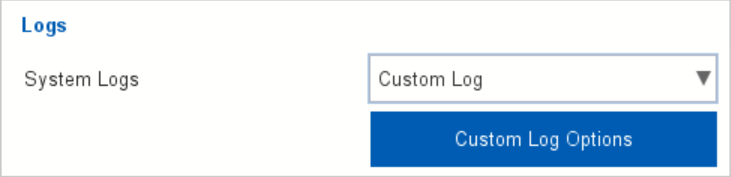
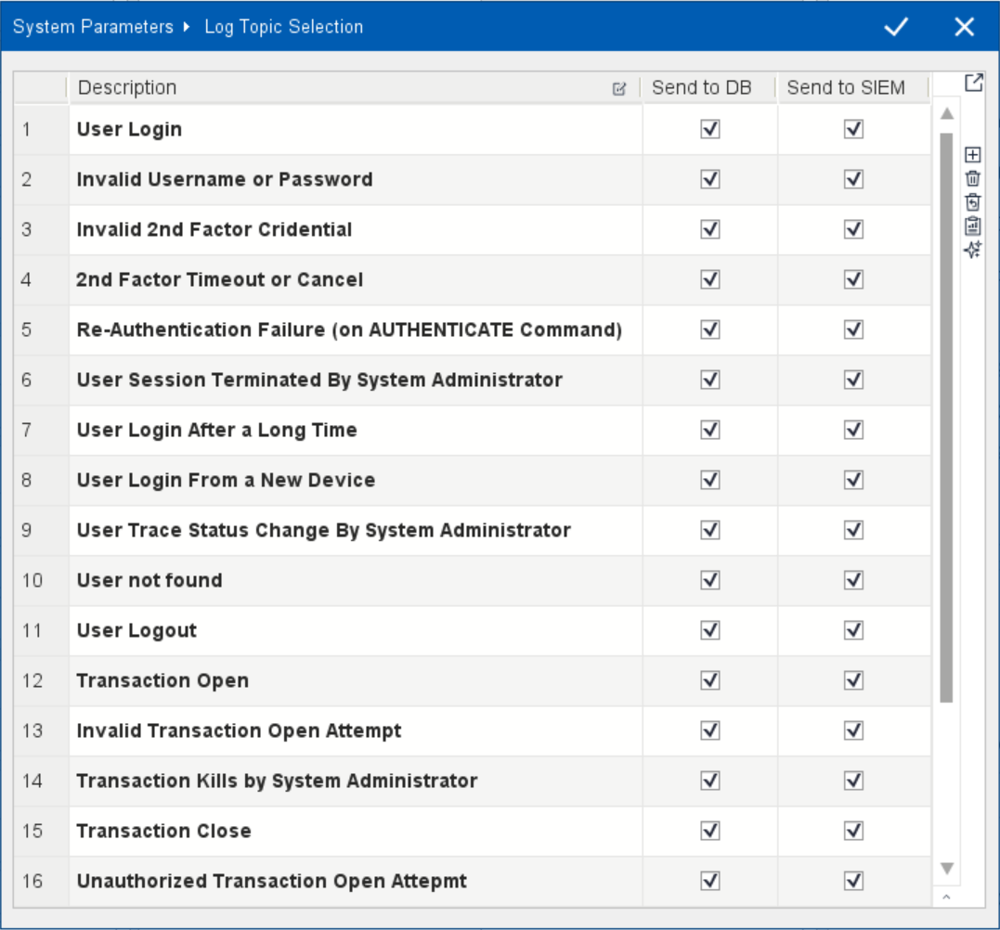

=========================================
Logging
=========================================

*TROIA Platform has an advanced logging infrastructure with various log options. This section aims to introduce all logging capabilities of the platform.*

Basics of Logging
=================

From an architectural perspective, the TROIA Platform involves two distinct logging domains. The first comprises logs related to a user's actions when attempting to connect to a specific database; examples include logging in, requesting to launch an application, or opening a document for viewing.

The second category consists of logs pertaining to the system's own infrastructure, rather than being directly linked to a specific database. Examples of such logs include server memory status and operations like shutting down or starting up the server.

This section focuses on the logs within the first domain—specifically those generated at the user level following a connection to a particular database.

Whether or not such logs are kept can be configured on a per-database basis. In other words, different logging strategies can be implemented for databases accessible via the same application server.

Log Content
-----------

This logs are stored on SYSIALOGS table on database that user requests to log in. It is also possible to pass these logs to 3rd party SIEM systems, we will discuss it under another title in this section.

The SYSIASLOGS table contains many details regarding user actions; here is the list of featured columns and their details.
::

	USERN			: username
	SESSIONID		: session id
	TRANS			: transaction
	TRANSACTIONID		: transaction id
	MESSAGE			: log content / log message
	LOGTOPIC		: lot topic
	LOGTIME			: log time as milliseconds
	CREATEDAT		: log time
	CREATEDBY		: username (similar to USERN column)
	
For the full column list of SYSIASLOGS, please see the table on "DEVT01 - System Tables" transaction.

Log Topics
============

"Log Topic" is a kind of subject id for the log. System administrators can configure log strategies topic by topic. 

All log messages inserted in the source code of the TROIA Platform contains a log topic. When the action (the subject of the log) occurs, system checks loggin configuration for the topic and decides to store or ignore the log. This confiuration also contains sending or not sending a log to SIEM systems.

Here are some log topics:

::

	User Login
	Invalid Username or Password
	Invalid 2nd Factor Cridential
	2nd Factor Timeout or Cancel
	Re-Authentication Failure (on AUTHENTICATE Command)
	User Session Terminated By System Administrator
	User Login After a Long Time
	User Login From a New Device
	User Trace Status Change By System Administrator
	User not found
	User Logout
	Transaction Open
	Invalid Transaction Open Attempt
	Transaction Close
	Unauthorized Transaction Open Attepmt
	Active Transaction Process Terminated by Administrator
	Troia Messages
	Invalid Service Call

Getting Actual List of Log Topics
---------------------------------

Most of the logs are generated internally by TROIA Platform, therefore log topics are internal. To get the actual list of log topics programmatically you can call GETLOGTOPICS() system function. This system function returns id and description of all available log topics.

Triggering this system function is not the only way to view all log topic options. It is also possible to get list on "SYS06 - System Parameters" trasanction which is used for also log configuration. This transaction also uses GETLOGTOPICS() in the background.

Log Configuration
=================

As we mentioned before it is possible to implement different logging strategies for different databases. So the main key of logging options is stored on database on ISSYSLOG column of IASSYSTEM table. This value is managed under "SYST06 - System Parameters" -> "System Logs".

In "System Logs" section on SYST06, there are some options **Closed**, **Brief**, **Detail (Transaction)**, **Detail (Transaction+Mesages)**,**Custom**. It is obvious that in "Closed" option system does not store logs. 

**Brief**, **Detail (Transaction)**, **Detail (Transaction+Mesages)** options enables some predefined log topics. Here is the available log topics for these predefined sets:

::
	
	Brief
	---------
	User Login
	User Logout
	Invalid Username/Password
	Invalid 2nd Factor Cridential
	Logs From APPENDLOGENTRY Command (Topic Id : 10000+))
	
	Detail (Transaction)
	--------------------
	+ Brief Mode
	Transaction Open
	Invalid Transaction Open Attempt
	Transaction Close
	Unauthorized Transaction Open Attepmt
	
	Detail (Transaction+Mesages)
	---------------------------
	+ Detail (Transaction)
	TROIA Messages
	Invalid Service Call
	
Custom Log Configuration
------------------------
	
**Custom** option is only available 9.03+ canias versions. And enables more detailed logging configuration options. If you select custom option system shows "Custom Log Options" button.

   
When you click this configration button system shows configuration dialog. In this dialog it is possible to decide whether this log data will be stored on database or send to SIEM system for each log topic. So it is possible to make more detailed custom log configuration.

   
This custom log configuration is stored on SYSLOGTOPICS table. In login attempt system reads custom log configuration, therefore changes are applied for the users who logs in after configuration change.

	
Writing Logs with TROIA
=======================

In some instances, it is necessary to generate log messages within TROIA code itself. These logs must undergo the same processes as other logs—such as validation checks, transmission to third-party SIEM software, and triggering of various alert mechanisms.

The ADDLOGENTRY command is used for such scenarios. After performing the necessary checks, the ADDLOGENTRY command writes the log generated within the TROIA code to the target tables and transmits it to the relevant systems. Therefore, directly inserting log data into the SYSIASLOGS table is not a correct practice and is not recommended. This command is avaliable on 26.10.06-01 and following builds. Here is the syntax of ADDLOGENTRY command.

::
	
	ADDLOGENTRY {message};
	ADDLOGENTRY {message} LOGLEVEL {loglevel};
	ADDLOGENTRY {message} LOGTOPIC {logtopic};
	ADDLOGENTRY {message} LOGLEVEL {loglevel} LOGTOPIC {logtopic};
	
And here is a sample code that appends an log message.

::

	OBJECT:
		STRING LOGMESSAGE;
	
	LOGMESSAGE = 'invalid check table content';

	ADDLOGENTRY LOGMESSAGE LOGLEVEL 'ERROR';
	
{loglevel} is a string typed parameter. This parameter's value must be ERROR, WARN or INFO. System applies log level filters due to this it's value. If it is not provided default level is INFO.

Log Topic on ADDLOGENTRY Command
--------------------------------
Log Topic is an optional integer parameter. If it is not provided default value is 10000. [0-9999] interval is reserved for TROIA Platform log topics, so in business layer this value must be greater than 10000. Otherwise system ignores ADDLOGENTRY log command and writes an error to trace. Using different numbers on TROIA layer logs can be distingished topic by topic. 

It is also possible to enable/disable logs that comes from ADDLOGENTRY command. To enable these kind of logs "Logs From APPENDLOGENTRY Command (Topic Id : 10000+))" must be enabled on "SYS06 - System Parameters" -> "Custom Log Options".

SIEM Integration
================

It is possible to send log messages to SIEM systems. To do this, the log topics to be sent to the SIEM must be marked on SYST06, and the connected server must have a valid SIEM configuration. 

To configure SIEM at the server layer, the following variables in the Server Configuration must be edited.

::

	SIEMType
	SIEMAddress
	SIEMLogTopics
	SIEMLogLevel
	SIEMAdapter

	
SIEM Type
---------

SIEM type is a kind of protocol definition to communicate with different types of SIEM Systems. "UDP" is the only available option. Here is sample configuration line for SIEM Type.

::

	SIEMType = UDP

SIEM Address
------------

SIEM Address is the address of SIEM System. Host and port are separated by a column (:) char. Two sample configuration lines are below:

::
	
	SIEMAddress = 192.168.10.10:9999
	
	SIEMAddress = mysiemhost.com:9999

SIEM Log Topics
----------------

SIEM Log Topics are a kind of filter string that allows system administrators reduce log count by topics. It is a comma(,) separated log topic id list that contains only allowed log topic ids. If it is not provided or set to asterisk(*) char, system sends all log topics to SIEM system. Here is sample configuration lines:

::

	#all topics transferred to SIEM
	SIEMLogTopics = *
	
	#only business level logs transferred to SIEM
	SIEMLogTopics = 10000
	
	#only login and logout
	SIEMLogTopics = 1000, 1900

	

SIEM Log Level
--------------

SIEM Log Level is another filter option to manage logs transferred to SIEM system. Value of this parameter must be one of ERROR,WARN,INFO,DEBUG. Sysem sends only logs those severity level is higher and equal. Default value is DEBUG and does not apply any filter and sends all logs to SIEM.

Here is a sample line:

::

	# filter DEBUG logs and send INFO,WARN and ERROR to SIEM. 
	SIEMLogLevel = INFO

SIEM Adapter
-------------

SIEM Adapter allows system administrators to select log format that will be passed to SIEM System. Supported protocols are SYSLOG RFC3164, SYSLOG RFC5424, SYSLOG RFC5425 all these standards has different customization options and their own formats. For more information about SYSLOG Formats please apply specific resources.

SYSLOG RFC3164
--------------

RFC 3164 (BSD Syslog Protocol) defines the legacy message format used to send event notification messages over IP networks. Characteristically, it contains host name that generating the log. Here is the syntax and sample for server configuration:

::

	#syntax
	#SYSLOGRFC3154 HOST {hostname}

	#sample configuration line
	SIEMAdapter = SYSLOGRFC3154 HOST troiaserver1
	
Now your log content contains "troiaserver1" is added to log content as hostname.

SYSLOG RFC5424 / RFC5425
------------------------

RFC 5424 is the modern Syslog Protocol standard, standardized by the IETF (Internet Engineering Task Force) and used for the transmission of event notification (syslog) messages. Here is the syntax and sample

SYSLOGRFC5424 HOST {hostname} [PEN {privateEnterpriseNumber}] [ENTERPRISEID {enterpriseId}] [TZKNOWN {tzKnown}] [ISSYNCED {isSynced}] [SYNCACCURACY {syncAccuracy}]

::
	
	#sample configuration line
	SIEMAdapter = SYSLOGRFC5424 HOST server1 PEN pen.number ENTERPRISEID eid TZKNOWN true ISSYNCED true SYNCACCURACY saAsNumber

RFC 5425 is very similar to RFC 5425. Here is the syntax and sample

SYSLOGRFC5425 HOST {hostname} [PEN {privateEnterpriseNumber}] [ENTERPRISEID {enterpriseId}] [TZKNOWN {tzKnown}] [ISSYNCED {isSynced}] [SYNCACCURACY {syncAccuracy}]

::

	#sample configuration line
	SIEMAdapter = SYSLOGRFC5425 HOST server1 PEN pen.number ENTERPRISEID eid TZKNOWN true ISSYNCED true SYNCACCURACY saAsNumber

Sending Logs Directly to SIEM
=============================

It is also possible to pass data to configured SIEM system directly, by TROIA. In this case, logs are not filtered due to SIEMLogTopics and SIEMLogLevel configurations, because this is a kind of forcing to send log to SIEM System.

**It is not recommended to use SIEMAPPEND command unless passing only to SIEM is must.** It direcly for communicates with SIEM not adds log to the logging subsystem and IASSYSTEM table which stores log files.

Here is the syntax:

::

	SIEMAPPEND MESSAGE {logcontent};
	SIEMAPPEND MESSAGE {logcontent} LOGLEVEL {level};
	

Default log level is INFO for SIEMAPPEND command. 

Some Useful Functions and Commands
==================================

For optimizing log analysis performance, TROIA some special commands and functions.

FILLLOGTABLE Command
--------------------

FILLLOGTABLE Command gets and table variable and returns same table with an extra colum named LOGTOPICTEST. This colum contains calculated human readible Log Topic text due to LOGTOPIC column of parameter table. Command loops whole table, finds correspoinding log topic text for each row internally. Here is the syntax and sample code.

::

	FILLLOGTABLE TABLE {table};
	
::

	OBJECT: 
	TABLE LOGTABLE,
	DATETIME LAST1HOUR;
	
	LAST1HOUR = SYS_CURRENTDATE - (60 * 60 * 1000);
		
	SELECT * FROM SYSIASLOGS 
		WHERE CLIENT = SYS_CLIENT 
				AND USERN = SYS_USER
				AND CREATEDAT > LAST1HOUR
				INTO TMPTABLE;
				
	FILLLOGTOPICS TABLE TMPTABLE;

